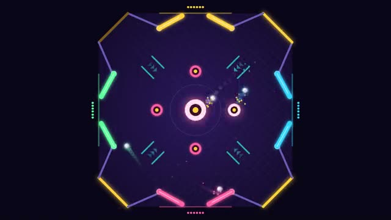

# Pinball Party

One pinball table, every side a goal. Flip fast. A multiplayer starter game from [Multiplayer Agent](https://multiplayeragent.com): 2D, versus, 2–4 players, with bots that fill empty seats.

## How it plays

Everyone guards a side of one shared pinball table with two flippers. Bat the balls off bumpers, boost lanes and corner targets to score, and drain them past your rivals. Three balls through your gate and you're out; last flipper standing wins.

**Controls:** ← → (or A / D) for your left and right flipper, Space for both; on touch, tap the left or right half.

## Make it yours in the Game Builder

Open the [Game Builder](https://multiplayeragent.com), choose **Start from a starter game** and pick Pinball Party. It opens as version 1 in your studio, ready to play and publish. Then ask for changes, for example:

- Add a spinning bumper in the middle that moves
- Light all four corners to turn every ball into a fireball
- Turn it into a candy table with gumball balls

## Run it yourself

1. Get a free publishable key (`pk_…`) at [multiplayeragent.com](https://multiplayeragent.com).
2. In `index.html`, put it in place of `pk_REPLACE_ME` in the `MP_CONNECT` block.
3. Open `index.html` in a browser. No build step and no server needed.

Without a key it still runs, offline against bots.

## How it is built

- One `index.html`. The comment at the top of the script maps the code and explains the multiplayer.
- **Live sync:** Everyone sees the same balls and every flipper move.
- **Host-run physics:** The host's browser runs the balls, bumpers and scores; your own flipper hits count the moment you see them. If the host leaves, the next player takes over.
- **Bots:** Bots guard empty sides and flip on time (mostly).
- **Leaderboard:** Each player's best match score.
- `?attract` runs it offline with bots only. The preview video is recorded from it.

## License

MIT.
